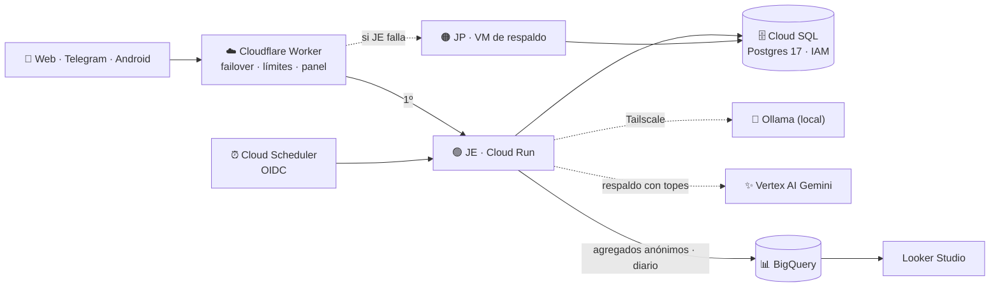

# CENTINELA 🛡️ · Antes de contestar, sabe quién te llama

**Centinela identifica llamadas de estafa y spam en Colombia con lo que ya sabe la comunidad:** cada reporte protege a la siguiente persona, y te avisa **antes de contestar**.

**👉 Pruébalo en vivo:** https://centinela.juan-gallego-sec.workers.dev

[](https://github.com/juan-student1/surprised-system/actions/workflows/ci.yml)

---

## El problema
En Colombia contestar un número desconocido es una apuesta: el **falso banco** que pide el código del SMS, el **wangiri** (llamada perdida internacional para que la devuelvas y te cobren tarifa premium), la extorsión, la cobranza y el telemarketing que nadie pidió. Solo las denuncias de fraude telefónico ante la Policía subieron 18 % en 2024 (13.600 casos, y la mayoría nunca se denuncia), y **cada víctima lo vive sola**: lo que aprende una persona no le sirve a la siguiente.

## La solución
| Canal | Qué haces |
|---|---|
| 🌐 **Web** (instalable en el celular) | Escribes el número y ves su riesgo, sus reportes y el tipo de fraude. Reportas en 10 segundos. Le preguntas al asistente de IA. |
| 🤖 **Telegram** | Le mandas el número al bot, reportas con `/reportar` y recibes un resumen cada mañana. |
| 📱 **App Android** | Cuando suena la llamada, el celular te avisa solo con una notificación de riesgo. |

**Riesgo de 0 a 100** calculado por **personas distintas** que reportan (1 → 30, 2 → 50, 3 → 65 alto, 5 → 83), con decaimiento en el tiempo y +25 para prefijos de wangiri. Una sola persona no puede "hundir" un número. Si 3 personas reportan el mismo número en 15 minutos, se dispara una **alerta de campaña**.

## Por qué confiar en Centinela
- **No se cae.** Dos servidores en redes distintas (Google Cloud Run y la VM de JP) detrás de un gateway en Cloudflare: si uno falla, el otro atiende en **menos de un segundo**. Si la base de datos falla, los reportes se guardan en el nodo y se sincronizan al volver.
- **Privado por diseño.** No guardamos tu IP ni tu nombre (solo un hash anónimo); los números se muestran **enmascarados** en público; la IA corre **en un equipo propio** y la nube solo entra de respaldo, con datos anonimizados.
- **Seguro y auditado.** Puerta única por el gateway, base de datos accesible solo con identidad de Google (IAM), panel con contraseña + 2FA, CI con gitleaks, trivy, ruff, tests y shellcheck en cada cambio. Modelo de amenazas STRIDE y checklist OWASP API Top 10 en [`docs/roles/JP_SEGURIDAD.md`](docs/roles/JP_SEGURIDAD.md).
- **Barato de operar.** ≈ **11 USD/mes** en total (casi todo es la base de datos).

## Para empresas
Cooperativas, bancos pequeños, call centers y operadores: **alertas cuando suplantan tu marca, consulta por API y panel de campañas.** Planes **Gratis**, **Pro** ($14.900 COP/mes) y **Empresa** (desde $790.000 COP/mes, piloto). Escríbenos desde la sección [Para empresas](https://centinela.juan-gallego-sec.workers.dev/#empresas). Detalle comercial: [`docs/roles/JM_VENTAS.md`](docs/roles/JM_VENTAS.md).

---

## Arquitectura



| Si se cae… | Qué pasa | El usuario nota |
|---|---|---|
| **JE** | El gateway lo marca caído 30 s y todo va a JP; vuelve solo | Nada |
| **La base de datos** | Reportes a SQLite local, consultas desde caché, sincroniza al volver | Respuestas desde caché |
| **La IA local** | Responde Gemini (con topes) o reglas | Nada / respuestas más simples |
| **Un ataque de tráfico** | Cloudflare lo absorbe; límites por IP en el borde y en el nodo | Nada |

Decisiones (ADR), costos y diagrama completo: [`docs/roles/JE_ARQUITECTURA.md`](docs/roles/JE_ARQUITECTURA.md).

## Para desarrolladores

```bash
python3 -m venv .venv && . .venv/bin/activate
pip install -r servidor/app/requirements.txt -r requirements-dev.txt
pytest && ruff check .                                   # 122 tests, sin red ni BD real
uvicorn --app-dir servidor/app main:app --reload         # API local (sin DATABASE_URL: modo degradado)
cd gateway && npx wrangler dev                           # gateway + web en local
```

```
servidor/app/        API FastAPI (igual en JE y JP) + Dockerfile de Cloud Run
gateway/             Cloudflare Worker: failover, límites, panel /admin (Resumen, Arquitectura, Seguridad, Ventas, IA)
web/                 Web pública + PWA
nube/                Scripts de Google Cloud en orden (IAM, Cloud SQL, secretos, despliegue, Vertex, BigQuery)
db/                  Esquema y migraciones (001‑005)
analitica/           Vistas de BigQuery para Looker Studio
ia/                  Ollama y flujos de n8n (bot de Telegram y avisos)
android/             App "Centinela llamadas"
tests/               pytest · CI en .github/workflows/ci.yml
docs/                Guías numeradas, roles y tablero
```

Reglas del repo (público, sin secretos; confirmación antes de tocar la nube; una fase = una rama = un PR): [`CLAUDE.md`](CLAUDE.md).

## Documentación
| Tema | Documento |
|---|---|
| **Estado del proyecto (empezar aquí)** | [`docs/ESTADO_ACTUAL.md`](docs/ESTADO_ACTUAL.md) |
| Pitch y guion de sustentación | [`docs/13_PITCH.md`](docs/13_PITCH.md) · checklist de la expo [`docs/18_EXPO.md`](docs/18_EXPO.md) |
| Arquitectura en la nube (Cloud Run, Cloud SQL, IAM) | [`docs/15_CLOUD_RUN_CLOUD_SQL_IAM.md`](docs/15_CLOUD_RUN_CLOUD_SQL_IAM.md) |
| IA híbrida (Ollama + Vertex AI Gemini) | [`docs/16_VERTEX_AI.md`](docs/16_VERTEX_AI.md) |
| Analítica (BigQuery + Looker Studio) | [`docs/17_LOOKER_STUDIO.md`](docs/17_LOOKER_STUDIO.md) |
| Auditoría de seguridad | [`docs/14_AUDITORIA_Y_MEJORAS.md`](docs/14_AUDITORIA_Y_MEJORAS.md) |
| Roles | [JE · Arquitectura](docs/roles/JE_ARQUITECTURA.md) · [JP · Seguridad](docs/roles/JP_SEGURIDAD.md) · [JM · Ventas](docs/roles/JM_VENTAS.md) |
| Plan maestro e historia | [`docs/00_PLAN_MAESTRO.md`](docs/00_PLAN_MAESTRO.md) |
| Nodo de respaldo y prueba de failover | [`docs/02_JP_SERVIDOR_RESPALDO.md`](docs/02_JP_SERVIDOR_RESPALDO.md) · [`docs/12_PRUEBA_CON_JP.md`](docs/12_PRUEBA_CON_JP.md) |
| Telegram, n8n e IA en el Lenovo | [`docs/06_TELEGRAM_N8N.md`](docs/06_TELEGRAM_N8N.md) · [`docs/11_LENOVO_IA.md`](docs/11_LENOVO_IA.md) |
| Llamadas reales (Android / iPhone) | [`docs/07_LLAMADAS_REALES.md`](docs/07_LLAMADAS_REALES.md) |

## Equipo
**JE** (Juan) · Arquitectura — **JP** · Seguridad — **JM** · Ventas
Ingeniería de Sistemas, semestre 8.

*Toda la gloria a Dios.*
