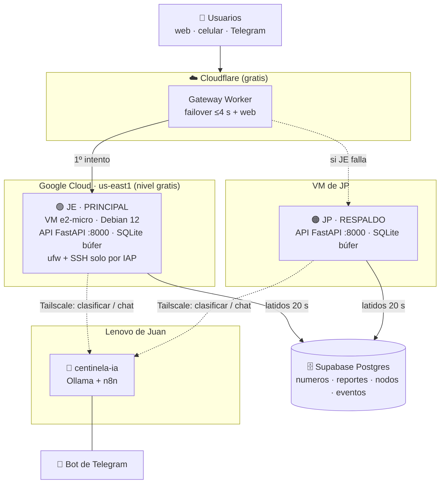

# CENTINELA 🛡️ — Plan maestro

**Sistema distribuido, tolerante a fallos, que identifica llamadas spam y estafas telefónicas con ayuda de la comunidad y de una IA local.**

Ingeniería de Sistemas · Semestre 8 · Grupo JE + JP

---

## 1. La idea en una frase

Cada persona que recibe una llamada rara la reporta (web, Telegram o automáticamente desde el celular). Centinela junta los reportes en una base de datos, calcula un **puntaje de riesgo 0‑100** por número, una **IA local (Ollama)** lee las descripciones y clasifica el tipo de fraude, y cualquiera puede preguntar *"¿me contesta o no?"* a un chatbot en la web o en Telegram. Todo corre en **dos nodos en clúster** (una VM gratis en Google Cloud y la VM de JP): si se apaga el principal, el respaldo atiende sin que el usuario lo note.

**¿Por qué impacta?** Resuelve un problema real que todos sufren (en Colombia las llamadas de cobranza, falsos bancos y "llamadas perdidas" internacionales son diarias) y en la sustentación se puede **desconectar el servidor en vivo** y mostrar que todo sigue funcionando.

---

## 2. Arquitectura

> **Cambio 2026‑11‑17:** el nodo **JE** dejó el PC de mesa y ahora es una **VM e2‑micro en Google Cloud** (`us-east1`). La IA (`centinela-ia`) pasa al **Lenovo** de Juan. JP sigue de respaldo en su VM. La URL pública de JE **no cambió** (mismo nombre en Tailscale), así que el gateway quedó igual.

Gateway → JE/JP entra por **Tailscale Funnel** (HTTPS público sin abrir puertos); JE, JP y el Lenovo se hablan por la **red privada Tailscale**. Si el Lenovo está apagado, el chatbot responde **por reglas** y los reportes quedan sin clasificar (se reclasifican después). Si Supabase cae, cada nodo guarda en SQLite y sincroniza al volver.

### Roles de cada máquina

| Equipo | Nombre en Tailscale | Rol | Qué corre |
|---|---|---|---|
| VM e2‑micro en Google Cloud (`us-east1`, Debian 12, 1 GB) | `centinela-je` | **Principal** | API Centinela, Funnel, búfer SQLite |
| VM de JP | `centinela-jp` | **Respaldo** (activo‑activo) | Lo mismo que JE |
| Lenovo de Juan | `centinela-ia` | Cerebro IA + automatización | Ollama, n8n, bot de Telegram |
| Cloudflare | `centinela.<cuenta>.workers.dev` | Puerta de entrada pública | Gateway con failover + web |
| Supabase | — | Base de datos compartida | PostgreSQL |

### Decisiones de ingeniería (para defender en la sustentación)

1. **Base de datos compartida en la nube (Supabase)** → los dos servidores son *sin estado*; cualquiera puede atender cualquier petición. Eso hace el failover instantáneo y sin pérdida de datos. Se descartó replicar Postgres entre JE y JP porque con 4 GB de RAM y Wi‑Fi doméstico la réplica sería frágil y el *promote* manual.
2. **Failover en el borde (Cloudflare Worker)** → el Worker prueba JE; si no responde en 4 s o da error 5xx, reenvía a JP en la misma petición. Se usa Worker y no DNS porque el DNS tarda minutos en cambiar.
3. **Tailscale Funnel** → cada servidor tiene HTTPS público gratis sin abrir puertos en el router (lo que pide la universidad).
4. **Modo degradado** → si Supabase se cae, cada nodo guarda los reportes en SQLite local y responde desde caché; cuando vuelve la nube, sincroniza solo y deja el evento en la bitácora. *(Probado: ver §6.)*
5. **IA local, no en la nube** → Ollama corre en el PC con más potencia; los servidores lo consultan por la red privada. Si el PC de IA está apagado, el chatbot responde con reglas (degradación elegante).
6. **Privacidad** → nunca se guarda la IP ni el usuario real: solo un hash anónimo. RLS activado en Supabase para bloquear su API pública.
7. **Servidores en consola** → sin escritorio gráfico se liberan ~400‑600 MB de RAM en equipos de 4 GB.
8. **JE en una VM de Compute Engine y no en Cloud Run** → la arquitectura necesita un proceso **siempre encendido** (latidos cada 20 s, sincronización de SQLite) y **Tailscale** (Funnel + IA por red privada). Cloud Run apaga la CPU sin peticiones, su disco es efímero (se perdería el búfer SQLite), el arranque en frío puede superar los 4 s del failover y Tailscale no corre normal dentro del contenedor. La e2‑micro entra en el **nivel gratis** y reutiliza `instalar_nodo.sh` sin reescribir nada.
9. **Cero puertos públicos en la nube** → se borraron las reglas por defecto de RDP e ICMP; SSH solo desde el túnel **IAP** de Google (`35.235.240.0/20`, exige login en la cuenta). El tráfico web entra por Tailscale Funnel. Dentro de la VM, `ufw` niega todo lo demás y `fail2ban` vigila SSH.
10. **Mínimo gasto del crédito** → solo un recurso cobra: la IP pública efímera (~3,6 USD/mes, necesaria para salir a internet; Cloud NAT costaría ~30). Disco **estándar** (no "equilibrado"), sin snapshots, sin Ops Agent, sin IP estática. Alerta de presupuesto desde el día 1 sin contar créditos.

### Cómo se calcula el riesgo

- Reportes de personas distintas: 1 → 30, 2 → 50, 3 → 65, 5 → 83 (curva `100·(1−e^(−0.35·n))`, evita que una sola persona "hunda" un número).
- Prefijos conocidos de estafa *wangiri* (Costa de Marfil +225, Ghana +233, Caribe +1 809/876…): +25.
- Número extranjero: +10. Reportes viejos (>30 / >90 días) pesan menos.
- Lista blanca (`verificado = true`): 0.
- Nivel: 🟢 bajo < 25 ≤ 🟠 medio < 60 ≤ 🔴 alto.

---

## 3. Estado actual

**En producción (2026‑11‑17):**
- Gateway: `https://centinela.juan-gallego-sec.workers.dev`
- JE: `https://centinela-je.tailaf5c0b.ts.net` — **VM e2‑micro Google Cloud** (`us-east1-b`, Debian 12), RAM ~46 % con zram. Antes (2026‑11‑02): Mint 22.2 en consola, RAM 63 % → 17 %
- JP: `https://centinela-jp.tailaf5c0b.ts.net` (respaldo, en su VM)
- IA: `centinela-ia` en el Lenovo de Juan (pendiente de instalar), Ollama
- BD: Supabase, proyecto `centinela`
- Prueba extremo a extremo OK: reporte → clasificación IA → chatbot con `fuente: ollama`. Latencia gateway 0.6‑1.9 s.

### Archivos

| Carpeta | Contenido | Estado |
|---|---|---|
| `db/schema.sql` | Tablas numeros, reportes, nodos, eventos | ✅ probado en PostgreSQL 16 |
| `servidor/app/` | API FastAPI del nodo (11 rutas) | ✅ probado: 2 nodos, failover, modo degradado, IA |
| `servidor/instalar_nodo.sh` | Convierte Debian/Ubuntu/Mint/Arch en servidor (JE o JP) en un comando; detecta Google Cloud (SSH por IAP) | ✅ JE en Google Cloud (2026‑11‑17) · ⏳ JP |
| `gateway/` | Cloudflare Worker con failover | ✅ probado: apagando JE responde JP |
| `ia/instalar_ollama.sh` | Ollama + Tailscale en Omarchy | ✅ `centinela-ia` con qwen2.5:7b |
| `ia/instalar_n8n.sh` | n8n + webhook público para Telegram | ⏳ fase 3 |

### Rutas de la API

| Método | Ruta | Para qué |
|---|---|---|
| GET | `/health` | Estado del nodo (BD, IA, CPU, RAM, temperatura) |
| GET | `/api/numero/{numero}` | Ficha de riesgo de un número |
| POST | `/api/reportar` | Reportar `{numero, categoria?, descripcion?, canal, reportero_id?}` |
| GET | `/api/top` | Números más peligrosos |
| GET | `/api/recientes` | Últimos reportes (para el "feed en vivo") |
| GET | `/api/stats` | Totales, por categoría, por canal, por día |
| GET | `/api/cluster` | Nodos en línea, latidos, bitácora de eventos |
| POST | `/api/chat` | Chatbot: detecta números en el mensaje y responde con IA |
| GET | `/gateway/estado` | (Worker) Qué nodo está activo y su latencia |

Categorías: `estafa`, `telemarketing`, `cobranza`, `encuesta`, `wangiri`, `suplantacion`, `extorsion`, `otro`.

---

## 4. Fases y responsables

### Fase 1 — Infraestructura (esta semana)
| # | Tarea | Quién | Guía |
|---|---|---|---|
| 1.1 | Crear proyecto Supabase y correr `schema.sql` | JE | `04_NUBE.md` |
| 1.2 | Subir esta carpeta a GitHub | JE | `04_NUBE.md` |
| 1.3 | Instalar nodo **JE** (`instalar_nodo.sh JE`) | JE | `01_JE_SERVIDOR_PRINCIPAL.md` |
| 1.4 | Instalar Ollama en PC personal | JE | `03_PC_PERSONAL_IA.md` |
| 1.5 | Instalar Linux Mint XFCE en laptop JP | JP | `02_JP_SERVIDOR_RESPALDO.md` |
| 1.6 | Instalar nodo **JP** (`instalar_nodo.sh JP`) | JP + JE (auth key) | `02_JP_SERVIDOR_RESPALDO.md` |
| 1.7 | Publicar Gateway en Cloudflare | JE | `04_NUBE.md` |
| 1.8 | Prueba de failover | Ambos | `05_PRUEBAS.md` |

### Fase 2 — Web profesional (siguiente sesión con Claude)
Una sola página, responsive, animada, servida desde el mismo Worker:
- **Hero** con buscador gigante: "¿Quién te está llamando?" → tarjeta de riesgo animada (velocímetro 0‑100).
- **Reportar** en 2 clics, con categorías en íconos.
- **Mapa de calor / feed en vivo** de reportes recientes (de qué canal y qué nodo los atendió).
- **Panel "Clúster en vivo"**: JE y JP como dos tarjetas con latido animado, CPU/RAM/temperatura; al apagar JE se ve el cambio a JP en tiempo real. ← *el momento "wow" de la sustentación*.
- **Chatbot Centinela** flotante (IA local).
- Estadísticas: top 10, por categoría, últimos 14 días.
- Sección "Cómo protegerte" (consejos anti‑estafa).

### Fase 3 — Bot de Telegram con n8n
Flujo: *Telegram Trigger → Switch por comando → HTTP Request al Gateway → Telegram Send*.

| Comando / acción | Qué hace |
|---|---|
| `/start` | Bienvenida y menú con botones |
| Enviar un número | Ficha de riesgo 🟢🟠🔴 |
| `/reportar 3001234567 me ofrecieron un crédito` | Guarda el reporte; la IA lo clasifica |
| `/top` | Los 10 más peligrosos |
| `/estado` | Qué servidor está atendiendo (JE/JP), latencias |
| Texto libre | Va al chatbot con Ollama |
| Reenviar un contacto | Extrae el número y lo consulta |
| (automático 7:00 a. m.) | Resumen diario al grupo del curso |
| (automático) | Alerta al grupo admin si un nodo deja de latir > 1 min |

### Fase 4 — Extras "fuera de serie" (si hay tiempo)
1. **Alerta en el celular cuando entra la llamada** (Android + MacroDroid gratis): al timbrar, consulta `/api/numero/{número}` y muestra notificación "🔴 Riesgo alto: posible estafa". Esto cumple literalmente "identificar el número antes de contestar".
2. **Reporte desde el registro de llamadas**: botón compartir → bot de Telegram.
3. **Detector de campañas**: la IA agrupa reportes similares en 24 h ("ola de llamadas de falso Bancolombia desde números 601...").
4. **Panel de auditoría**: bitácora de eventos del clúster exportable a PDF para la entrega.
5. **Tercer nodo**: el PC personal también puede correr la API como nodo de emergencia.

---

## 5. Riesgos conocidos y cómo se manejan

| Riesgo | Mitigación |
|---|---|
| Supabase gratis se pausa tras 7 días sin uso | Los latidos cada 20 s lo mantienen activo |
| Supabase caído | Modo degradado con SQLite + sincronización automática |
| PC de IA apagado | Chatbot responde con reglas; reportes quedan sin clasificar y se pueden reclasificar después |
| n8n solo corre en el PC personal | Aceptado para la demo; en fase 4 el bot puede migrarse a JP |
| VM de 1 GB de RAM | zram 50 % (zstd) + API limitada a 600 MB; uso real ~46 % |
| Gasto del crédito de Google Cloud | Solo e2‑micro del nivel gratis; alerta de presupuesto de 5‑10 USD sin contar créditos; ver §7 |
| Tailscale caído en la VM | Acceso de emergencia por SSH vía IAP desde Cloud Shell |
| Wi‑Fi inestable en los servidores | Preferir cable de red; Tailscale reconecta solo |
| 4 GB de RAM | Modo consola + zram + límite de 600 MB a la API |

---

## 6. Pruebas ya realizadas (en ambiente de laboratorio)

| Prueba | Resultado |
|---|---|
| Reporte en JE, consulta en JP (estado compartido) | ✅ mismo dato en ambos |
| Puntaje: 1, 2, 3 reportantes distintos | ✅ 30 → 50 → 65 (alto) |
| Prefijo +1 809 (wangiri) | ✅ +25 al puntaje |
| Número inválido | ✅ HTTP 422 |
| Base de datos apagada → reporte | ✅ "modo degradado", guardado local |
| Base de datos vuelve | ✅ sincronizado en < 30 s, evento en bitácora |
| IA clasifica "dicen ser del banco y piden clave" | ✅ `suplantacion` + resumen |
| IA apagada → chat | ✅ respuesta por reglas |
| Gateway con JE apagado | ✅ responde JP, encabezado `X-Centinela-Failover` |

Lo que falta probar en el hardware real está en `05_PRUEBAS.md`.

---

## 7. Costos en Google Cloud y cierre del curso

| Recurso | Costo |
|---|---|
| VM e2‑micro `us-east1` | $0 (nivel gratis) |
| Disco estándar 20 GB | $0 (nivel gratis hasta 30 GB) |
| IP pública efímera | ~3,6 USD/mes (lo único que cobra) |
| Tráfico de salida | $0 (< 1 GB/mes) |
| **Estimado hasta diciembre** | **~4‑6 USD de los 300 de crédito** |

**Al terminar el curso (diciembre), en este orden:**
1. Google Cloud → selector de proyectos → `centinela` → **Configuración → Cerrar (shut down)** el proyecto (borra la VM, el disco y la IP de una vez).
2. **Facturación → Administración de cuentas → Cerrar cuenta de facturación.**
3. **Facturación → Métodos de pago → quitar la tarjeta** (Google no deja quitarla con la cuenta abierta). Luego eliminar la tarjeta virtual en la app del banco.
4. Telegram: **@BotFather → `/revoke`** del token del bot.
5. Tailscale: borrar las máquinas `centinela-*` que ya no se usen.
6. PC de mesa: `sudo rm -rf /opt/centinela` (el `.env` del nodo viejo).
