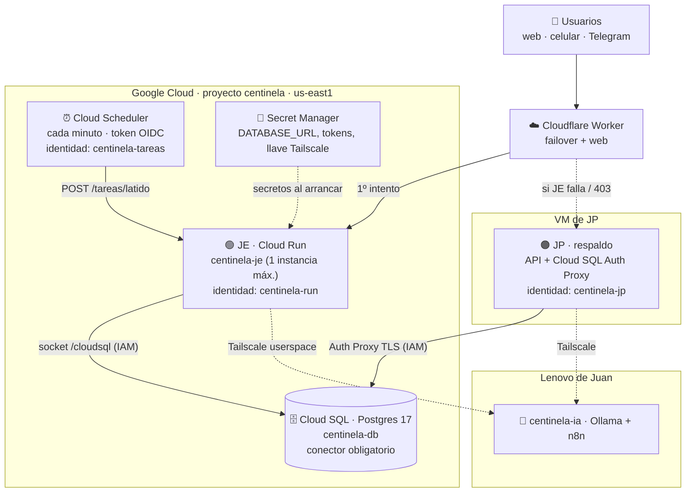

# 15 · JE en Cloud Run + base de datos en Cloud SQL + IAM

> **Cambio 2026‑11‑18 (pedido del profesor):** el nodo JE deja la VM e2‑micro y pasa a **Cloud Run**; la base de datos se migra de Supabase a **Cloud SQL (PostgreSQL 17)**; todo el acceso entre piezas se controla con **IAM** (cuentas de servicio con un solo propósito y roles mínimos).
> JP sigue siendo el respaldo en su VM y ahora llega a Cloud SQL por el **Cloud SQL Auth Proxy**.
> Scripts: carpeta [`nube/`](../nube) (se corren en **Cloud Shell**, en orden).

---

## 1. Arquitectura nueva



| Pieza | Antes | Ahora |
|---|---|---|
| Nodo JE | VM e2‑micro + Tailscale Funnel | **Cloud Run** `centinela-je` (URL `https://centinela-je-…run.app`) |
| Base de datos | Supabase (AWS N. Virginia) | **Cloud SQL** `centinela-db`, Postgres 17, `us-east1` |
| Latido / sincronización | Bucles dentro del proceso | **Cloud Scheduler** cada minuto → `POST /tareas/latido` |
| Secretos | `/opt/centinela/.env` en la VM | **Secret Manager**, uno por secreto |
| Acceso SSH | IAP a la VM | No hay servidor que administrar |
| JP → BD | Internet → Supabase pooler | **Cloud SQL Auth Proxy** con cuenta de servicio |

---

## 2. Decisiones (para defender en la sustentación)

### 2.1 ¿Por qué Cloud Run ahora sí funciona?
Antes descartamos Cloud Run por 4 problemas. Así se resolvió cada uno:

| Problema | Solución en el código |
|---|---|
| Cloud Run congela la CPU sin peticiones → los bucles de latido (20 s) no corren | Si existe `K_SERVICE` (variable que pone Cloud Run) la API **no** arranca bucles. **Cloud Scheduler** llama `POST /tareas/latido` cada minuto, que hace latido + sincronización + chequeo de IA en una sola pasada (`servicios.tareas_programadas`). |
| Disco efímero → se perdería el búfer SQLite | El búfer queda en `/tmp` (sirve mientras viva la instancia). Con la BD en la misma región de Google, el modo degradado es un caso raro; y si JE falla, JP conserva su búfer en disco. |
| Arranque en frío > timeout del gateway | `--cpu-boost` (más CPU al arrancar) y el latido cada minuto mantiene la instancia caliente (Cloud Run la apaga tras ~15 min sin tráfico). Si aun así tarda, el gateway responde con JP: eso es justamente el failover. |
| Tailscale no corre normal en contenedor | Tailscale en **modo userspace** (sin `/dev/net/tun`), método oficial de Tailscale para Cloud Run. Abre un proxy HTTP en `localhost:1055` que la API usa **solo** para hablar con Ollama. La llave es *ephemeral*: cada instancia que muere se borra sola de la red. |

**Detalle importante:** `--max-instances=1`. El modo mantenimiento del panel (botón "detener JE") vive en memoria; con 2 instancias una estaría "detenida" y la otra no.

### 2.2 Configuración de Cloud Run
| Opción | Valor | Por qué |
|---|---|---|
| Región | `us-east1` | La misma de Cloud SQL (latencia de ~1 ms a la BD) y la más cercana a Colombia de las regiones baratas |
| CPU / memoria | 1 vCPU / 512 MiB | La API usa ~150 MB; Tailscale ~30 MB |
| Facturación | por petición (por defecto) | Solo se cobra mientras atiende; entra en el nivel gratis (180.000 vCPU‑s/mes) |
| min / max instancias | 0 / 1 | Costo ~0 y estado de mantenimiento consistente |
| Concurrencia | 40 | Una sola instancia atiende varias peticiones a la vez (FastAPI) |
| Timeout | 120 s | El chat con IA puede tardar hasta 90 s |
| Entorno | gen2 | Sistema de archivos y red completos (lo necesita Tailscale) |
| Usuario del contenedor | `centinela` (uid 10001), no root | Si alguien rompe la API, no es root dentro del contenedor |
| Acceso público | `allUsers` → `roles/run.invoker` | El Worker de Cloudflare debe poder llamarlo; la API tiene su propia seguridad (secreto del gateway, límites por IP, tokens) |

### 2.3 ¿Por qué Cloud SQL y cómo se configuró?
| Opción | Valor | Por qué |
|---|---|---|
| Motor | PostgreSQL **17** | El esquema es Postgres puro; 17 permite usar `pg_dump` 17 contra Supabase sin conflicto de versiones |
| Edición | **Enterprise** (no Enterprise Plus) | Con PG17 Google propone Enterprise Plus por defecto, que cuesta varias veces más |
| Máquina | `db-f1-micro` (núcleo compartido, 0,6 GB) | La más barata; la carga del proyecto es mínima |
| Disco | HDD 10 GB, sin autoincremento | Lo más barato; la BD pesa < 50 MB |
| Disponibilidad | Zonal (sin réplica HA) | La alta disponibilidad del proyecto la da el clúster JE/JP, no la BD; HA duplicaría el costo |
| Copias | Diarias 08:00 UTC, se guardan 7 | Si alguien borra datos, se restaura (costo de centavos) |
| **Conector obligatorio** (`--connector-enforcement=REQUIRED`) | Sí | Nadie puede conectarse por IP + contraseña: **solo** Cloud Run y el Auth Proxy, que exigen identidad IAM. Una contraseña robada sola no sirve. |
| SSL | `ENCRYPTED_ONLY` | Todo el tráfico cifrado |
| Redes autorizadas | Ninguna | No hace falta: el conector autentica con IAM |
| Protección contra borrado | Activada | Un `delete` por error no la borra |

**Usuarios de la base (privilegio mínimo también dentro de Postgres):**
- `centinela_app` → dueño de las tablas. Lo usa **JE**. Creado con `gcloud`.
- `centinela_jp` → creado **por SQL**, no por `gcloud` (los que crea `gcloud` quedan como `cloudsqlsuperuser`). Solo `SELECT/INSERT/UPDATE/DELETE`; no puede crear ni borrar tablas.
- **RLS desactivado** (`db/003_cloudsql.sql`): en Supabase bloqueaba su API REST pública; en Cloud SQL esa API no existe, y con RLS sin políticas `centinela_jp` no vería nada.

### 2.4 IAM: quién puede hacer qué

| Identidad | Roles | Alcance | Para qué |
|---|---|---|---|
| `centinela-run@…` (cuenta de servicio de Cloud Run) | `roles/cloudsql.client` | proyecto | Conectarse a Cloud SQL (no puede administrarla ni borrarla) |
| | `roles/secretmanager.secretAccessor` | **cada secreto, uno por uno** | Leer solo los secretos de Centinela, no todos los del proyecto |
| `centinela-tareas@…` | ninguno en el proyecto | — | Solo es la identidad del token OIDC del latido |
| Agente de Cloud Scheduler | `roles/iam.serviceAccountTokenCreator` | **solo sobre `centinela-tareas`** | Firmar tokens como esa cuenta y nada más |
| `centinela-jp@…` | `roles/cloudsql.client` | proyecto | El Auth Proxy de JP. Una sola llave, revocable |
| `allUsers` | `roles/run.invoker` | servicio `centinela-je` | Que el gateway pueda llamar a JE (y quitándolo se demuestra el failover) |
| Juan | Owner | proyecto | Administrador |
| Profesor (opcional) | `roles/viewer` | proyecto | Ver todo sin poder cambiar nada |
| JP (opcional) | `run.viewer`, `cloudsql.viewer`, `logging.viewer`, `cloudscheduler.viewer` | proyecto | Ver logs y estado para depurar su nodo |

Lo que **no** se usó, a propósito:
- La **cuenta de servicio por defecto** de Compute (tiene rol *Editor* = casi todo). Cloud Run corre con `centinela-run`, que solo puede dos cosas.
- Llaves JSON para Cloud Run: no tiene ninguna; Google le da credenciales temporales automáticamente. La única llave es la de JP (está fuera de Google y no hay otra forma). Se puede revocar en un comando.

**¿Cómo se protege `/tareas/latido` si el servicio es público?** Cloud Scheduler manda un **token OIDC firmado por Google** a nombre de `centinela-tareas`. La API verifica la firma con las llaves públicas de Google, la audiencia (`centinela-tareas`) y que el correo sea exactamente esa cuenta (`rutas.py`, ruta `/tareas/latido`). Sin token → 401; con token de otra cuenta → 403. No hay una contraseña compartida que se pueda filtrar.

### 2.5 Failover: lo que cambió en el gateway
El Worker ahora considera caído un nodo si la respuesta **no trae `X-Centinela-Nodo`** (`gateway/worker.js`, `esDeCentinela`). Toda respuesta real de la API lo trae; un 403 de IAM o un 404 de Google no. Eso habilita la demo:

```bash
bash nube/08_failover.sh apagar    # quita run.invoker a allUsers → 403 → el gateway salta a JP
bash nube/08_failover.sh estado
bash nube/08_failover.sh prender   # lo devuelve
```
También sigue funcionando el botón "detener JE" del panel (modo mantenimiento → 503).

---

## 3. Paso a paso (Cloud Shell)

**Antes:** abrir <https://console.cloud.google.com> → proyecto `centinela` → ícono **`>_`** (Cloud Shell).

```bash
gcloud config set project ID_DEL_PROYECTO
git clone https://github.com/juan-student1/surprised-system.git   # o: cd surprised-system && git pull
cd surprised-system
```

| # | Comando | Qué hace | Tiempo |
|---|---|---|---|
| 1 | `CORREO_PROFE=… CORREO_JP=… bash nube/01_apis_y_iam.sh` | APIs, 3 cuentas de servicio, roles mínimos (los correos son opcionales) | 2 min |
| 2 | `bash nube/02_cloud_sql.sh` | Instancia, base `centinela`, usuario `centinela_app`, claves aleatorias en Secret Manager | 5‑10 min |
| 3 | `bash nube/03_secretos.sh` | Copia los tokens del `.env` de la VM a Secret Manager (sin mostrarlos) y pide la llave de Tailscale | 1 min |
| 4 | `bash nube/04_migrar_datos.sh` | Esquema + usuario `centinela_jp` + copia de datos desde Supabase, con conteo de verificación | 1 min |
| 5 | `bash nube/05_desplegar.sh` | Construye la imagen y despliega JE en Cloud Run; prueba `/health` | 4 min |
| 6 | `bash nube/06_scheduler.sh` | Latido cada minuto con OIDC; muestra el clúster | 1 min |

**Llave de Tailscale (paso 3):** <https://login.tailscale.com/admin/settings/keys> → *Generate auth key* → **Reusable**, **Ephemeral**, **Pre‑approved**, 90 días.

### Cambio de tráfico (hacerlo seguido, en un momento de poco uso)
1. **Copia final de datos:** `bash nube/04_migrar_datos.sh` (vacía el destino y copia de nuevo).
2. **Gateway** (en el PC, no en Cloud Shell): en `gateway/wrangler.toml` poner
   `NODO_PRINCIPAL = "https://centinela-je-XXXX.us-east1.run.app"` (la URL que dio el paso 5) y
   ```bash
   cd gateway && npx wrangler deploy
   curl -s https://centinela.juan-gallego-sec.workers.dev/gateway/estado     # "activo":"JE"
   ```
3. **JP a Cloud SQL:** `bash nube/07_llave_jp.sh` → pasarle la llave y la clave a JP por privado → en la VM de JP:
   ```bash
   cd ~/surprised-system && git pull
   sudo bash servidor/conectar_cloudsql.sh ~/centinela-jp.json PROYECTO:us-east1:centinela-db
   sudo bash servidor/actualizar.sh
   ```
4. **Prueba de failover:** `bash nube/08_failover.sh apagar` → reportar un número desde la web → `bash nube/08_failover.sh prender` → el reporte se ve desde JE.
5. **Borrar la VM:** `bash nube/99_borrar_vm.sh` (comprueba antes que Cloud Run responda) y borrar la máquina `centinela-je` vieja en el panel de Tailscale.
6. **Supabase:** dejarlo pausado una semana como respaldo y luego borrar el proyecto.

### Actualizar JE después de un cambio de código
```bash
cd ~/surprised-system && git pull && bash nube/05_desplegar.sh
```
Cada despliegue crea una **revisión** nueva; si algo falla se vuelve a la anterior en segundos:
`gcloud run services update-traffic centinela-je --region us-east1 --to-revisions=REVISION_ANTERIOR=100`

---

## 4. Operación

| Para… | Comando |
|---|---|
| Logs en vivo de JE | `gcloud beta run services logs tail centinela-je --region us-east1` (o Consola → Cloud Run → Registros) |
| Estado / URL | `gcloud run services describe centinela-je --region us-east1` |
| Entrar a la BD (consola SQL) | Consola → Cloud SQL → `centinela-db` → **Cloud SQL Studio**, usuario `centinela_app` |
| Ver latidos | Consola → Cloud Scheduler → `centinela-latido` (último intento y estado) |
| Rotar un secreto | `printf '%s' 'NUEVO' \| gcloud secrets versions add centinela-control-token --data-file=-` y `bash nube/05_desplegar.sh` |
| Restaurar una copia | Consola → Cloud SQL → Copias de seguridad → Restaurar |
| Pausar la BD (no cobra CPU) | `gcloud sql instances patch centinela-db --activation-policy=NEVER` (`ALWAYS` para prender) |

## 5. Problemas comunes
| Síntoma | Causa | Solución |
|---|---|---|
| `/health` con `db:false` en JE | Falta `--add-cloudsql-instances` o el rol `cloudsql.client` | Correr de nuevo los pasos 1 y 5 |
| El despliegue falla por `Permission denied … secret` | `centinela-run` no tiene acceso a ese secreto | Correr de nuevo el paso 3 (vuelve a dar el permiso) |
| Scheduler en `PERMISSION_DENIED` o la API responde 401 | Falta el permiso del agente o la audiencia no coincide | Correr de nuevo el paso 6 |
| `ollama:false` en JE | Lenovo apagado, llave de Tailscale vencida o no puesta | Normal: chat por reglas. Llave nueva → paso 3 + paso 5 |
| JP con `db:false` | El proxy no arrancó (llave o conexión mal puestas) | `journalctl -u cloudsql-proxy -n 30` en JP |
| `Enterprise Plus` en la factura | Se creó la instancia sin `--edition=ENTERPRISE` | Usar el script; nunca crearla a mano con los valores por defecto |

## 6. Costos estimados (crédito de 300 USD)
| Recurso | Costo aproximado |
|---|---|
| Cloud SQL `db-f1-micro` + 10 GB HDD + copias | **~9‑11 USD/mes** (lo único que cobra en serio) |
| Cloud Run | 0 (nivel gratis: 2 M de peticiones, 180.000 vCPU‑s) |
| Cloud Scheduler | 0 (3 trabajos gratis por cuenta de facturación) |
| Secret Manager | < 0,50 USD/mes |
| Artifact Registry (imágenes) + Cloud Build | ~0 (0,5 GB y 2.500 min de build gratis) |
| VM e2‑micro + IP | **se elimina** (ahorra ~3,6 USD/mes) |
| **Hasta mediados de diciembre** | **~10‑15 USD de los 300** |

La alerta de presupuesto de `01_JE_SERVIDOR_PRINCIPAL.md` (paso 2) sigue igual: 5‑10 USD sin contar créditos. Con Cloud SQL conviene subirla a **15 USD**.

**Cierre del curso:** el mismo de `00_PLAN_MAESTRO.md` §7 (cerrar el proyecto borra Cloud Run, Cloud SQL, secretos y cuentas de servicio). Antes: `gcloud sql instances patch centinela-db --no-deletion-protection` si se quiere borrar solo la BD. Revocar también la llave de `centinela-jp` y la llave de Tailscale.
