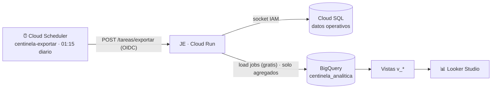

# 17 · Analítica: BigQuery + Looker Studio

> Fase 4 · Responsable: **JE** (datos) con **JM** (presentación a clientes) y **JP** (página de seguridad).
> Código: `servidor/app/centinela/exportar.py`, vistas en `analitica/vistas.sql`, script `nube/12_bigquery.sh`. Última revisión: 2026‑11‑25.

## 1. Cómo llegan los datos (y por qué así)



- **Cloud SQL tiene conector obligatorio** (solo entra quien tenga identidad IAM por el conector): Looker Studio no puede ni debe conectarse directo a la base de producción. La analítica vive aparte, en BigQuery.
- Una vez al día, Cloud Scheduler llama a JE con un token OIDC (igual que el latido). JE **recalcula los agregados de toda la historia** (hasta 400 días) y los sube con *load jobs* en modo `WRITE_TRUNCATE`: cada corrida deja las tablas completas → si un día falla, el siguiente lo corrige solo.
- **Qué NO sale nunca hacia BigQuery:** IPs, hashes de reporteros, descripciones de reportes, leads, dispositivos ni números completos. Los números salen **enmascarados** (`+57 300 ••• 4567`) y todo lo demás son **conteos** por día, prefijo, categoría, canal, nodo o proveedor de IA.

## 2. Tablas (todas particionadas por `fecha`, hora Colombia)

| Tabla | Una fila por… | Columnas clave |
|---|---|---|
| `reportes_diarios` | día | reportes, números distintos, personas distintas, números nuevos, con descripción, clasificados por IA, llamadas reales |
| `riesgo_por_prefijo` | día × indicativo | país, indicativo (`+57 601`, `+57 300`, `+1 809`…), tipo (fijo/celular/internacional/corto), ciudad y región (fijos de Colombia), wangiri, reportes, números, riesgo promedio, alto riesgo |
| `categorias` | día × tipo de fraude | reportes, clasificados por IA |
| `canales` | día × canal | reportes |
| `cluster` | día × nodo × tipo de evento | eventos (arranque, mantenimiento = demo de failover, reactivado, sincronización, campaña, análisis IA, exportación) |
| `seguridad` | día × nodo × código × ruta | bloqueos (401/403/429) |
| `uso_ia` | día × nodo × proveedor × tipo × resultado | llamadas, tokens, costo estimado (USD) |
| `top_numeros` | día × posición (1‑20) | número **enmascarado**, país, categoría, reportes del día, riesgo |

**Vistas para Looker** (`analitica/vistas.sql`): `v_kpis`, `v_tendencia_diaria`, `v_mapa`, `v_top_numeros_30d`, `v_categorias_30d`, `v_canales_30d`, `v_salud_cluster`, `v_seguridad_diaria`, `v_ia_diaria`, `v_costos_infra`.

> **Mapa por ciudad:** en Colombia solo los **fijos** tienen indicativo geográfico (601 Bogotá, 602 Cali, 604 Medellín, 605 Barranquilla, 606 Pereira, 607 Bucaramanga, 608 Ibagué; plan de numeración de la CRC de 2021). Los **celulares** (3xx) no dicen dónde está la persona: se muestran aparte, por los 3 primeros dígitos.

## 3. Costo (revisado antes de crear nada)

| Pieza | Uso de Centinela | Nivel gratis | Costo |
|---|---|---|---|
| BigQuery · almacenamiento | KB a pocos MB | 10 GiB/mes | **0** |
| BigQuery · carga (*load jobs*) | 8 cargas/día | Gratis siempre (no es *streaming*) | **0** |
| BigQuery · consultas | Cada gráfico de Looker lee KB | 1 TiB/mes | **0** |
| Cloud Scheduler | 2º trabajo (latido + exportación) | 3 por cuenta de facturación; hoy la cuenta tiene **1** | **0** |
| Cloud Run | 1 llamada diaria de ~10‑20 s | 180.000 vCPU‑s/mes | **0** |
| Looker Studio | Panel y enlaces de solo lectura | Gratis (no hace falta Looker Studio Pro) | **0** |

**Riesgo de costo:** prácticamente nulo. Lo único que podría cobrar sería un 4º trabajo de Scheduler en la misma cuenta de facturación (0,10 USD/mes).

## 4. Activar (en orden, con confirmación de Juan)

```bash
bash nube/12_bigquery.sh preparar    # dataset + permisos mínimos de centinela-run
bash nube/05_desplegar.sh            # JE v1.8.0 detecta el dataset y enciende la exportación
bash nube/12_bigquery.sh programar   # trabajo diario + primera exportación (toda la historia)
bash nube/12_bigquery.sh vistas      # vistas para Looker
```
Fuera de Cloud Shell, anteponer `PROYECTO=<id del proyecto centinela>`.

**Comprobar:** Consola → BigQuery → `centinela_analitica` → `reportes_diarios` → *Vista previa* con filas; `v_kpis` → *Ejecutar* `SELECT * FROM v_kpis`. En el panel → Resumen, la bitácora muestra el evento `exportacion`.

## 5. Armar el panel en Looker Studio (paso a paso)

**Antes:** entra a <https://lookerstudio.google.com> con la cuenta de Google que es **Owner** del proyecto.

### 5.1 Conectar los datos
1. **Crear → Fuente de datos → BigQuery** → *Mis proyectos* → `centinela` → `centinela_analitica` → `v_kpis` → **Conectar**.
2. En la pantalla de campos: *Credenciales de datos* = **Propietario** (así el profesor y JM ven el panel sin necesitar permisos en Google Cloud). *Actualización de datos* = **12 horas** (los datos cambian una vez al día).
3. Repetir para las demás vistas (`v_tendencia_diaria`, `v_mapa`, `v_top_numeros_30d`, `v_categorias_30d`, `v_canales_30d`, `v_salud_cluster`, `v_seguridad_diaria`, `v_ia_diaria`, `v_costos_infra`) y para la tabla `categorias` (tendencia por tipo).
4. En `v_mapa`: cambiar el tipo del campo `pais_iso` a **Geo → País** y `ciudad_geo` a **Geo → Ciudad**. En `v_kpis`, `variacion_reportes` y `pct_clasificado_ia_30d` a **Porcentaje**; `costo_ia_30d_usd` a **Moneda (USD)**.

### 5.2 Crear el informe
**Crear → Informe**, tema oscuro o claro con el azul de Centinela (`#2346D8`). Una página por tema; en cada página, un **cuadro de texto** arriba con la explicación para no técnicos (abajo va el texto sugerido, listo para copiar).

#### Página 1 · Portada
| Gráfico | Fuente | Configuración |
|---|---|---|
| 5 tarjetas de resultados | `v_kpis` | `reportes_30d`, `variacion_reportes`, `numeros_nuevos_30d`, `campanas_30d`, `failovers_demo_30d` |
| 3 tarjetas pequeñas | `v_kpis` | `llamadas_reales_30d`, `pct_clasificado_ia_30d`, `bloqueos_30d` |

> **Texto:** *"Centinela es una red comunitaria contra las estafas telefónicas en Colombia. Estas cifras resumen los últimos 30 días: cuántas llamadas sospechosas reportó la comunidad, cuántos números nuevos aparecieron, cuántas campañas de estafa coordinadas se detectaron y cuántas veces probamos que el sistema sigue funcionando aunque se caiga un servidor."*

#### Página 2 · Tendencias
| Gráfico | Fuente | Configuración |
|---|---|---|
| Serie temporal | `v_tendencia_diaria` | Dimensión `fecha`; métricas `reportes` (barras) y `promedio_7d` (línea) |
| Serie apilada por tipo | tabla `categorias` | Dimensión `fecha`, desglose `categoria_txt`, métrica `reportes` |
| Control de período | — | Últimos 30 días por defecto |

> **Texto:** *"Cada barra es un día. La línea suaviza los altibajos: si sube varios días seguidos, hay más intentos de estafa que de costumbre. Abajo se ve qué tipo de fraude explica el aumento."*

#### Página 3 · Mapa
| Gráfico | Fuente | Configuración |
|---|---|---|
| Mapa geográfico (países) | `v_mapa` | Geo `pais_iso`, métrica `reportes`, filtro `tipo = internacional` |
| Mapa de burbujas (Google Maps) | `v_mapa` | Ubicación `ciudad_geo`, tamaño `reportes`, color `score_promedio`, filtro `tipo = fijo` |
| Tabla | `v_mapa` | `indicativo`, `region`, `reportes`, `numeros`, `numeros_alto_riesgo`, filtro `tipo = celular` |

> **Texto:** *"De dónde vienen las llamadas reportadas. Los números fijos de Colombia sí dicen la región (601 es Bogotá, 604 Medellín…). Los celulares no dicen dónde está quien llama, por eso van en la tabla. Afuera de Colombia, los prefijos del Caribe (+1 809, +1 876) y de África occidental son típicos del 'wangiri': te timbran una vez para que devuelvas la llamada y te cobren tarifa internacional."*

#### Página 4 · Números más reportados
| Gráfico | Fuente | Configuración |
|---|---|---|
| Tabla con mapa de calor | `v_top_numeros_30d` | `numero_enmascarado`, `pais`, `categoria`, `reportes_30d`, `riesgo_actual` (mapa de calor), `nivel_actual` |

> **Texto:** *"Los números que más personas distintas reportaron este mes. Se muestran ocultos a propósito (+57 300 ••• 4567): este panel es para entender el problema, no para exponer a nadie. Para consultar un número completo, usa la web o el bot de Telegram."*

#### Página 5 · Tipos de fraude y canales
| Gráfico | Fuente | Configuración |
|---|---|---|
| Barras horizontales | `v_categorias_30d` | `categoria_txt`, `reportes`, orden descendente |
| Anillo | `v_canales_30d` | `canal`, `reportes` |
| Tarjeta | `v_categorias_30d` | suma de `clasificados_ia` |

> **Texto:** *"Qué tipo de estafa es más común y por dónde nos llegan los reportes (web, Telegram o la app del celular). Cuando la persona solo describe la llamada, la inteligencia artificial decide el tipo de fraude: esa tarjeta cuenta cuántas veces lo hizo."*

#### Página 6 · Salud del clúster y seguridad (JP)
| Gráfico | Fuente | Configuración |
|---|---|---|
| Columnas agrupadas | `v_salud_cluster` | `fecha`, desglose `nodo`, métricas `arranques`, `failovers_demo`, `sincronizaciones` |
| Columnas apiladas | `v_seguridad_diaria` | `fecha`; `sin_credencial_401`, `fuera_del_gateway_403`, `exceso_429` |

> **Texto:** *"Centinela corre en dos servidores (JE en Google Cloud y JP en otra máquina). Un 'failover' es cuando apagamos uno a propósito y el otro sigue atendiendo sin que nadie lo note. Abajo, los intentos que el sistema bloqueó: sin credenciales, intentando saltarse la puerta de entrada o mandando demasiadas peticiones."*

#### Página 7 · IA y costos
| Gráfico | Fuente | Configuración |
|---|---|---|
| Columnas apiladas | `v_ia_diaria` | `fecha`, desglose `proveedor`, métrica `respuestas` |
| Tarjetas | `v_ia_diaria` | suma `desde_cache`, suma `sin_cupo`, suma `costo_estimado_usd` |
| Tabla + tarjeta | `v_costos_infra` | `recurso`, `usd_mes`, `nota`; tarjeta con la suma de `usd_mes` |

> **Texto:** *"La IA de Centinela primero corre gratis en un computador del equipo (Ollama). Solo si ese computador no responde usamos Gemini en Google Cloud, con un límite de llamadas por hora y por día para que la factura nunca se dispare. Todo el sistema cuesta alrededor de 11 USD al mes; casi todo es la base de datos."*

### 5.3 Compartir
**Compartir → Invitar personas** (profesor, JP, JM) como **Lector**, o **Administrar el acceso al vínculo → Cualquier persona con el vínculo puede ver**. Como las credenciales son del propietario, nadie más necesita permisos en Google Cloud, y como los datos son agregados y enmascarados, el enlace se puede mostrar en la sustentación.

## 6. Problemas comunes
| Síntoma | Causa | Solución |
|---|---|---|
| Scheduler `centinela-exportar` en error 404 | JE desplegado antes de crear el dataset (exportación apagada) | `bash nube/05_desplegar.sh` de nuevo y `programar` |
| Error 500 y en el log `Access Denied ... bigquery` | Falta un permiso de `preparar` | Correr `bash nube/12_bigquery.sh preparar` otra vez (es idempotente) |
| Log `Exportar seguridad: sin datos (relation ... does not exist)` | Falta una migración en Cloud SQL | `bash nube/10_migracion.sh db/004_…` / `db/005_…` |
| Looker muestra datos viejos | Caché de 12 h | Ver → **Actualizar datos** |
| El mapa no pinta países | El campo no es geográfico | `pais_iso` → tipo **Geo → País** |
