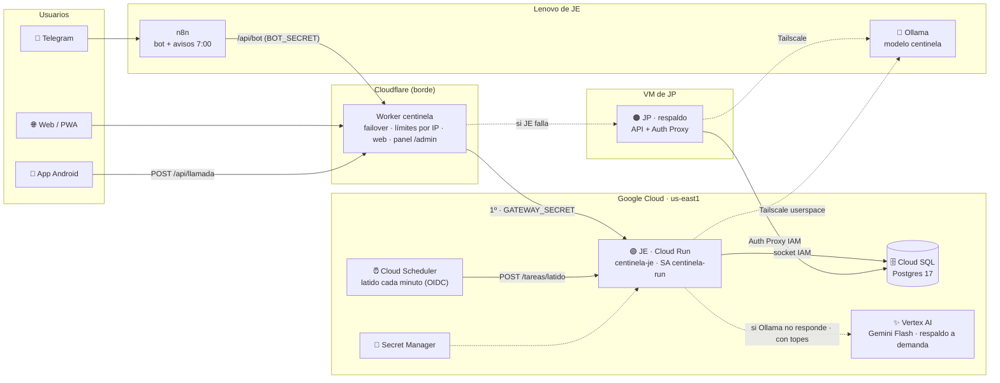

# JE · Arquitectura de Centinela

> Responsable: **JE (Juan)**. Interfaz: pestaña **Arquitectura** del panel (`/admin/arquitectura`), que muestra en vivo el estado de cada pieza.
> Detalle de despliegue: [`15_CLOUD_RUN_CLOUD_SQL_IAM.md`](../15_CLOUD_RUN_CLOUD_SQL_IAM.md). Última revisión: 2026‑11‑25.

## 1. Diagrama actual

**Flujo de una consulta:** el usuario abre la web → el Worker sirve la página → la web pide `/api/numero/…` → el Worker reenvía a JE con el secreto del gateway y la IP real → JE consulta Cloud SQL y responde → si JE no contesta en 6 s (o lo devuelve Google con 403/404), el Worker lo marca caído 30 s y reintenta en JP.

## 2. Decisiones de arquitectura (ADR)

Formato corto: **contexto → decisión → consecuencias**. Estado: ✅ vigente · 🔁 reemplazada.

### ADR‑001 · Gateway en Cloudflare Workers con failover activo‑pasivo ✅
- **Contexto:** dos nodos en redes distintas (Google Cloud y la casa de JP); hace falta un solo link y que la caída de uno no se note.
- **Decisión:** un Worker (plan gratis) es la única puerta. Prueba JE y, si falla, JP. Cortacircuito de 30 s guardado en memoria y en la Cache API.
- **Consecuencias:** + failover en < 1 s sin DNS ni balanceador pago; + absorbe DDoS en el borde. − Los límites por IP del Worker viven por datacenter (no son globales). − El estado del cortacircuito no es compartido entre todos los datacenters.

### ADR‑002 · JE en Cloud Run en vez de VM ✅ (reemplaza a ADR‑002a "VM e2‑micro" 🔁)
- **Contexto:** pedido del profesor (servicios administrados + IAM). La VM exigía parches, SSH y una IP pública paga.
- **Decisión:** Cloud Run gen2, 1 vCPU / 512 MiB, **0‑1 instancias**, facturación por petición, `--cpu-boost`.
- **Consecuencias:** + costo ~0 (nivel gratis); + sin servidor que administrar; + revisiones con rollback en segundos. − Arranque en frío (lo cubre el latido y, si no, el failover a JP). − Disco efímero (el búfer SQLite vive en `/tmp`).

### ADR‑003 · Cloud SQL con conector obligatorio ✅ (reemplaza a Supabase 🔁)
- **Contexto:** la BD estaba en otra nube (Supabase/AWS) con usuario y clave.
- **Decisión:** Postgres 17 Enterprise `db-f1-micro`, HDD 10 GB, zonal, `--connector-enforcement=REQUIRED`, sin redes autorizadas, SSL obligatorio.
- **Consecuencias:** + una clave robada sola no sirve (hace falta identidad IAM); + misma región que JE (~1 ms). − Es lo único que cobra en serio (~9‑11 USD/mes). − Sin alta disponibilidad: la HA del proyecto la da el clúster JE/JP, no la BD (decisión de costo).

### ADR‑004 · JP como respaldo heterogéneo en una VM propia ✅
- **Contexto:** un respaldo en la misma nube cae con la misma nube.
- **Decisión:** JP corre la misma API en otra máquina, otro proveedor de internet, publicada por Tailscale Funnel, y llega a Cloud SQL por el Auth Proxy con la cuenta `centinela-jp`.
- **Consecuencias:** + falla independiente de Google Cloud Run. − Depende de que la VM de JP esté prendida; − una llave JSON (revocable) fuera de Google.

### ADR‑005 · IA local (Ollama en el Lenovo) por Tailscale ✅
- **Contexto:** la IA en la nube cuesta por token y los reportes son datos sensibles.
- **Decisión:** modelo acotado `centinela` en Ollama dentro del Lenovo; JE llega por Tailscale en modo userspace (proxy `localhost:1055`), JP por Tailscale normal.
- **Consecuencias:** + gratis y privado; + si se apaga, nada se cae. − Disponibilidad atada al Lenovo → ADR‑013.

### ADR‑006 · Tareas por Cloud Scheduler + OIDC en vez de bucles ✅
- **Contexto:** Cloud Run congela la CPU sin peticiones; los bucles de fondo no corren.
- **Decisión:** `POST /tareas/latido` cada minuto con un token OIDC firmado por Google para `centinela-tareas`; la API verifica firma, audiencia y correo.
- **Consecuencias:** + sin contraseña compartida; + mantiene caliente a JE. − Un trabajo de Scheduler de los 3 gratis.

### ADR‑007 · Secret Manager, permiso secreto por secreto ✅
- **Decisión:** cada secreto es un recurso aparte y `centinela-run` solo puede leer los suyos (no `secretAccessor` de todo el proyecto). Para comparar entre equipos se usa la huella `sha256 | cut -c1-12`.
- **Consecuencias:** + privilegio mínimo y rotación por secreto. − Más comandos al rotar (lo hace `nube/03_secretos.sh`).

### ADR‑008 · Panel `/admin` en el borde, no en los nodos ✅
- **Decisión:** login PBKDF2 + TOTP + sesión firmada atada al navegador + anti‑CSRF en el Worker. En los nodos `/admin` da 404. Las pestañas (Arquitectura, Seguridad, Ventas) se arman en el servidor sin JavaScript.
- **Consecuencias:** + nadie puede atacar el login entrando directo a un nodo; + compatible con la CSP estricta. − El Worker necesita `CONTROL_TOKEN` para pedir datos internos a los nodos.

### ADR‑009 · Puerta única con `GATEWAY_SECRET` ✅
- **Decisión:** con el secreto configurado, el nodo rechaza (403) todo lo que no venga del Worker, salvo `/`, `/ping`, `/health`, `/tareas/latido` (OIDC) y `/api/control` (token). Solo se cree la IP que reenvía el Worker.
- **Consecuencias:** + las URLs públicas de Cloud Run y del Funnel dejan de ser un atajo; + el reportero no se puede falsificar (H1). − Si se rota el secreto hay que hacerlo a la vez en Worker, JE y JP.

### ADR‑010 · Modo degradado con SQLite local ✅
- **Decisión:** si la BD falla, reportes a una bandeja SQLite y consultas desde caché; se sincronizan en el siguiente latido.
- **Consecuencias:** + el usuario nunca ve un error por la BD. − En Cloud Run la bandeja muere con la instancia (caso raro: BD y JE están en la misma región).

### ADR‑011 · `max-instances=1` en JE ✅
- **Decisión:** el modo mantenimiento (demo de failover) y los límites por IP viven en memoria: con una sola instancia son coherentes.
- **Consecuencias:** + simple y barato. − Techo de capacidad (~40 peticiones concurrentes). Para escalar habría que mover ese estado a Memorystore/Firestore (no se justifica para el curso).

### ADR‑012 · Métricas de seguridad agregadas en memoria y volcadas en el latido ✅ (Fase 2)
- **Decisión:** cada 401/403/429 suma en un contador por (hora, código, grupo de ruta); el latido lo vuelca a `seguridad_hora`. Sin IPs.
- **Consecuencias:** + un ataque no genera una escritura a la BD por petición; + privacidad. − Si la instancia muere antes del latido se pierde menos de un minuto de conteo.

### ADR‑013 · IA híbrida: Ollama primero, Vertex AI Gemini de respaldo con topes ✅ (Fase 3)
- **Contexto:** con el Lenovo apagado el chat bajaba a reglas; el análisis de muchos reportes juntos no cabe en un modelo de 7B.
- **Decisión:** Ollama → Gemini (`gemini-3.8-flash`, endpoint `global`) → reglas. Gemini solo por acción de una persona, con tope por hora (20), por día (100), de análisis profundos (10/día), caché de 1 h y timeout de 20 s. Identidad `centinela-run` con `roles/aiplatform.user`. Detalle: [`16_VERTEX_AI.md`](../16_VERTEX_AI.md).
- **Consecuencias:** + el chat sigue "inteligente" aunque el Lenovo se apague; + análisis profundo a demanda. − Costo variable acotado por los topes; − lo que va a Gemini sale de nuestra red (por eso se anonimiza y lo sensible se queda local).

## 3. Costos mensuales estimados

| Recurso | Plan / tamaño | USD/mes |
|---|---|---|
| Cloud SQL | `db-f1-micro`, HDD 10 GB, copias 7 días | **9‑11** |
| Cloud Run (JE) | 0‑1 instancias, por petición | 0 (nivel gratis: 180.000 vCPU‑s, 2 M peticiones) |
| Cloud Scheduler | 1 trabajo (latido) | 0 (3 gratis por cuenta de facturación) |
| Secret Manager | ~10 secretos activos | ~0,60 |
| Artifact Registry | imágenes de cada despliegue | 0‑0,30 (0,5 GB gratis; borrar imágenes viejas) |
| Cloud Build | ~5 builds/semana | 0 (2.500 min/mes gratis) |
| Cloudflare Workers | plan gratis | 0 (100.000 peticiones/día) |
| Tailscale | plan personal | 0 |
| Telegram + n8n (autohospedado) | — | 0 |
| Lenovo (IA) y VM de JP | equipos propios | electricidad |
| **Total nube** | | **≈ 10‑12 USD/mes** (del crédito de 300 USD) |

**Vertex AI Gemini (Fase 3):** centavos en uso normal; peor caso acotado por los topes (orden de 10‑20 USD/mes, ver `16_VERTEX_AI.md` §4).
**Fase siguiente (por estimar antes de crear nada):** BigQuery dentro del nivel gratis (10 GB de almacenamiento y 1 TB de consultas al mes) y un segundo trabajo de Scheduler (Fase 4).

## 4. Qué mostrar en la sustentación (JE)
1. Este diagrama y por qué cada pieza está donde está (ADR 001‑006).
2. Panel → **Arquitectura**: todas las piezas en verde.
3. Panel → **Detener JE** → la pestaña muestra JE caído y el sitio sigue funcionando por JP.
4. Costos: menos de 12 USD/mes para un sistema distribuido con failover real.
